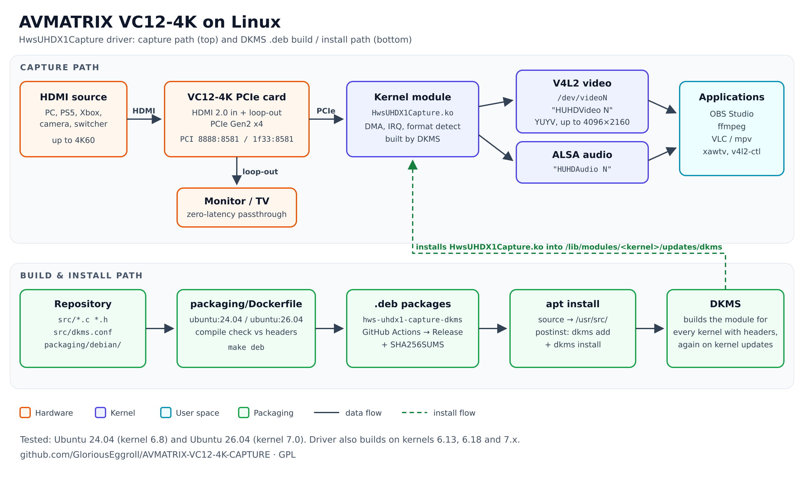

# AVMATRIX VC12-4K Linux driver

[](https://github.com/GloriousEggroll/AVMATRIX-VC12-4K-CAPTURE/releases/latest)
[](https://github.com/GloriousEggroll/AVMATRIX-VC12-4K-CAPTURE/actions/workflows/build-deb.yml)
[](LICENSE)

Linux driver (`HwsUHDX1Capture`) for the **AVMATRIX VC12-4K** PCIe HDMI 2.0 capture card (1 channel, up to 4K60),
with DKMS `.deb` packages for **Ubuntu 24.04 and 26.04**. The card appears as a V4L2 video device and an ALSA
audio device, so it works with OBS Studio, ffmpeg and VLC.

For the 4-channel VC41 / VC42 cards use
[AVMATRIX-VC41-VC42-CAPTURE](https://github.com/GloriousEggroll/AVMATRIX-VC41-VC42-CAPTURE).



## Install

Ubuntu 24.04 / 26.04, from the [latest release](https://github.com/GloriousEggroll/AVMATRIX-VC12-4K-CAPTURE/releases/latest):

```sh
sudo apt install linux-headers-$(uname -r)
sudo apt install ./hws-uhdx1-capture-dkms_*ubuntu24.04_all.deb   # or *ubuntu26.04*
```

Other distributions: `./dkms-install.sh` (needs `make`, `gcc`, `dkms` and kernel headers).

## Use

```sh
v4l2-ctl --list-devices   # HUHDVideo 1 → /dev/videoN
```

OBS Studio: **Video Capture Device (V4L2)** → `HUHDVideo 1`, **Audio Input Capture (ALSA)** → `HUHDAudio 1`.

## Uninstall

```sh
sudo apt remove hws-uhdx1-capture-dkms     # or: sudo ./scripts/hws-uninstall.sh
```

## Documentation

[doc/README.md](doc/README.md): hardware details, install options, ffmpeg examples, troubleshooting (Secure Boot,
headers), building the packages, CI and releases, where to buy, history.

Not affiliated with AVMATRIX. Licensed under the GPL, see [LICENSE](LICENSE).
